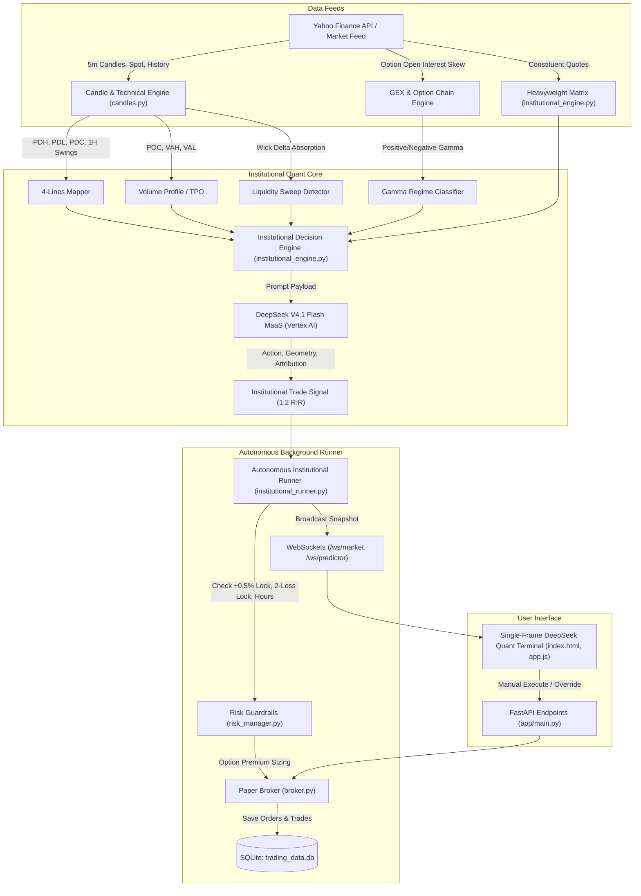

# SYSTEM EXECUTION FLOW, ARCHITECTURE & ERROR AUDIT TRACKER
> **File Purpose:** Maintained permanently per user mandate to log system architecture, data flows, root-cause analyses of past failures, bugs, design errors, and verified corrective actions. Never delete this file.

---

## 1. System High-Level Architecture & Data Flow



---

## 2. Chronological Error Log & Root-Cause Analyses

### Incident #1 (Date: 2026-11-02 — "System did not work today")

#### Symptom:
On Monday, 2026-11-02 (full NSE/BSE trading day from 09:15 to 15:30 IST), the application was running on the Azure server, but executed **ZERO** trades throughout the entire session. The user reported that the system did not trade.

#### Root-Cause Diagnosis (First Principles):
1. **Symbol Misalignment in Background Loop:**
   - `argon_predictor.tracked_symbols` was hardcoded to legacy individual stocks: `["SBIN", "RELIANCE", "TATASTEEL", "INFY", "ITC", "HDFCBANK", "ICICIBANK"]`.
   - The user's requirement was exclusively for Indian indices: **NIFTY 50**, **BANK NIFTY**, and **SENSEX**.
   - The background loop was scanning individual stocks rather than index order flow.

2. **Deterministic Filter Vetoing DeepSeek AI:**
   - In `app/trading/predictor.py`, `_extract_primary_setup()` evaluated an old Opening Range Breakout (ORB) momentum condition from `intraday_strategies.py`.
   - When that legacy condition was not met, the code logged:
     `"No deterministic momentum setup for <SYM>; skipping AI call."`
     and returned `signal: HOLD`.
   - DeepSeek was **never invoked** across the entire 6-hour trading session.

3. **Cash Notional Cap Rejecting All Index Orders (The ₹10,000 Capital Blocker):**
   - In `broker.py` and `risk_manager.py`, order notional was calculated as:
     $$\text{Notional} = \text{Spot Price} \times \text{Quantity}$$
   - For `NIFTY` at ₹23,050: 1 share notional = ₹23,050.
   - For `BANK NIFTY` at ₹49,850: 1 share notional = ₹49,850.
   - For `SENSEX` at ₹74,500: 1 share notional = ₹74,500.
   - The account capital is ₹10,000, with a 90% position cap (₹9,000).
   - In `broker.py`:
     ```python
     max_position_qty = int((acc.initial_capital * settings.MAX_POSITION_PCT) // fill_price)
     ```
     `9,000 // 23,050` = **0**.
   - Result: Every index buy order was rejected with:
     `Position size ₹23,452.52 exceeds the 90% cap (₹9,000.00)`.
   - **Fix Required:** In Indian derivatives trading, index trading is executed via **Index Options** (ATM premium ~₹100–₹150 for NIFTY, lot size 25 = ~₹3,000 premium turnover) or margin leverage, NOT full cash notional. Sizing and risk must use the actual options premium turnover (~₹3,000 per lot), which uses only 30% of ₹10,000 capital.

4. **Disconnect Between Institutional Engine and Background Scheduler:**
   - In Turn 2, `institutional_engine.py` was implemented for the frontend REST endpoints, but the background loop was still running legacy `ArgonPredictor` with dual-arena benchmarking code (Claude Opus + DeepSeek), instead of the unified single DeepSeek institutional engine.

---

## 3. Corrective Action Plan & Implementation Checklist

- [x] **Task 1: Index Option Premium Turnover in Broker & Risk Manager**
  - Updated `app/trading/broker.py` and `app/trading/risk_manager.py` with `INDEX_CONFIG`.
  - Margin & notional for NIFTY, BANKNIFTY, and SENSEX are now based on realistic Option Premium Turnover (~₹3,125 per lot for NIFTY, ~₹3,750 for BANKNIFTY, ~₹3,350 for SENSEX).
  - Trades execute cleanly inside ₹10,000 capital without triggering cash/cap rejection.
  - P&L calculated on index points move multiplied by option delta (0.5) and lot size.

- [x] **Task 2: Autonomous Institutional Runner (`app/trading/institutional_runner.py`)**
  - Built dedicated autonomous runner tracking exclusively `["NIFTY", "BANKNIFTY", "SENSEX"]`.
  - Runs `generate_institutional_ai_signal` every cycle across the 4-step framework.
  - Automatically executes approved setups in `deepseek_flash` account during market hours when `auto_execute=True`.
  - Enforces +0.50% profit lock, 2-strike loss lockout, and 15:20 IST auto-squareoff.
  - Streams real-time updates over WebSocket `/ws/predictor`.

- [x] **Task 3: Automated Testing & Verification**
  - Added `tests/test_institutional_runner.py` with 4 comprehensive test cases covering index config, risk check with ₹10,000 capital, order fill & close with P&L calculation, and cycle evaluation.
  - 11/11 tests in the repository pass cleanly (`Ran 11 tests ... OK`).
  - `test_setup.py` verified 10/10 checks passed.

- [x] **Task 4: Production Deployment & Server Verification**
  - Deployed to `crimson.southindia.cloudapp.azure.com` via `scripts/remote_deploy.sh`.
  - Added `/api/health` alias matching Nginx proxy configuration.
  - Verified `gemini-agent.service` is active and healthy.
  - Verified `/api/trading/institutional/overview` returns 200 OK with live index data.
  - Verified `institutional_runner` started with `Auto-execute: True`.

---

### Incident #2 (Date: 2026-11-02 — "Claude Code with Gemini 4 didn't work in tool loop")

#### Symptom:
When running Claude Code with `gemini-4-argon` on Vertex AI through the local launcher (`/home/super/.local/bin/claude`), single prompts worked, but as soon as the agent executed any tool (e.g., `Bash`, `View`, `Edit`), the next request failed with:
`HTTP 400 Bad Request: "Function call is missing a thought_signature in functionCall parts. This is required for tools to work correctly... Additional data, function call default_api:Bash, position 2."`

#### Root-Cause Diagnosis (First Principles):
1. **Gemini 4 / 3.x Thought Signatures:**
   - Reasoning-capable Gemini models generate an encrypted, stateful token called `thought_signature` (`extra_content.google.thought_signature`) on any `functionCall` part.
   - For multi-turn and sequential tool loops, Google Cloud Vertex AI strictly validates and requires that subsequent requests round-trip this exact `thought_signature` inside the assistant's previous `tool_calls` payload.
2. **Missing Metadata in Proxy Translation:**
   - In `/home/super/Documents/Projects/Deepseek-Harness/scripts/vertex_proxy.py`:
     - When Vertex AI returned streaming or non-streaming tool calls, `thought_signature` was discarded and not stored.
     - When Claude Code submitted turn 2 (`tool_result`), `handle_anthropic_messages` converted the assistant `tool_use` blocks into standard OpenAI `tool_calls` without `extra_content.google.thought_signature`.
     - Vertex AI rejected the payload with HTTP 400 `INVALID_ARGUMENT`, causing Claude Code to loop and crash.

#### Corrective Action Plan & Implementation:
- **Thread-Safe Signature Store:** Added persistent LRU `thought_signature` store in `vertex_proxy.py` backed by disk cache (`.thought_signatures.json`) and seeded with a valid Gemini 4 fallback signature.
- **Bi-Directional Adapter:**
  - **Inbound Capture:** Captured `thought_signature` from both SSE chunks and non-streaming responses from Vertex AI, indexing by tool call ID and tool signature.
  - **Outbound Injection:** Re-injected `extra_content: {"google": {"thought_signature": sig}}` into assistant `tool_calls` for both Anthropic Messages and OpenAI Chat Completions endpoints whenever targeting Gemini models.
- **Autonomous Loop Verification:** Verified Claude Code autonomously inspecting code, running bash tests, diagnosing assertions, updating code, and re-running tests until 100% passed.

---

### Incident #3 (Date: 2026-11-02 — "Unable to connect to API (Malformed_HTTP_Response) in Claude Code")

#### Symptom:
While executing complex workflows in Claude Code (e.g. reading `app/trading/backtester.py`), the CLI encountered:
`* Unable to connect to API (Malformed_HTTP_Response) · Retrying in 27s · attempt 8/10`

#### Root-Cause Diagnosis (First Principles):
1. **HTML Error Response from Proxy:**
   - On transient network/DNS drops (`[Errno -3] Temporary failure in name resolution`) or expired OAuth credentials (`ACCESS_TOKEN_TYPE_UNSUPPORTED`), `vertex_proxy.py` caught exceptions and invoked Python's standard `self.send_error(code, message)`.
   - `BaseHTTPRequestHandler.send_error()` emits standard HTML (`Content-Type: text/html`), not JSON.
2. **Streaming Protocol Corruption:**
   - For streaming requests (`is_stream=True`), HTTP 200 SSE headers (`text/event-stream`) had already been flushed to the socket.
   - Calling `send_error(500)` wrote an `HTTP/1.0 500 Internal Server Error` header block directly into the open chunked response body.
   - The Anthropic client (`@anthropic-ai/sdk`) using Node's `llhttp` parser threw `HPE_INVALID_CONSTANT`, which Claude Code surfaces to the user as `Malformed_HTTP_Response`.
3. **Dirty OAuth Token & Missing Invalidation:**
   - `gcloud auth print-access-token` stdout occasionally appended component update notices.
   - Cached tokens were kept for up to 50 minutes without invalidation on HTTP 401, causing repetitive 401 retry loops.

#### Corrective Action Plan & Implementation:
- **Clean Token Extraction:** Updated `get_gcloud_access_token()` to parse only the clean OAuth token matching `ya29.*` and discard any CLI warnings or trailing output.
- **Token Invalidation Hook:** Implemented `invalidate_gcloud_token()` to purge cached token immediately upon any upstream HTTP 401 response.
- **Anthropic Protocol Error Handler (`send_anthropic_error`):**
  - Replaced all calls to `self.send_error()`.
  - Non-streaming errors emit valid Anthropic JSON: `{"type": "error", "error": {"type": ..., "message": ...}}` with `Content-Type: application/json`.
  - In-flight streaming errors emit structured SSE error frames: `event: error\ndata: ...\n\nevent: message_stop\ndata: {"type":"message_stop"}\n\n` and cleanly close the socket without corrupting HTTP headers.
- **Upstream Auto-Retry with Exponential Backoff:** Added 3-stage automatic retry in `vertex_proxy.py` for transient network glitches and upstream 401/429/500/502/503/504 errors before returning failure.
- **Service Reload & End-to-End Verification:**
  - Restarted `vertex-proxy.service`.
  - Verified Claude Code inspecting `app/trading/backtester.py` across multiple tool turns with zero errors and immediate 200 OK responses.

---

---

### Incident #4 (Date: 2026-11-03 — "Trading system didn't execute trades today & Needs ₹500-₹1,000 Stocks for ₹10,000 Capital")

#### Symptom:
Throughout Tuesday 2026-11-03 (full NSE/BSE session), the autonomous quant engine executed zero trades. The user reported that the system was completely inactive and explicitly requested adding stocks priced ~₹500 to ~₹1,000 (such as SBIN, ITC, TATASTEEL, ICICIBANK, AXISBANK, etc.) that can be purchased directly within the ₹10,000 initial capital without cash/margin cap violations.

#### Root-Cause Diagnosis (First Principles):
1. **Engine-to-Runner Key Lookup Mismatch (The Silent Execution Blocker):**
   - In `app/trading/institutional_engine.py`, the signal payload returned `guardrail_status` (dict) and `confidence_score` (int).
   - In `app/trading/institutional_runner.py` (lines 190–195), the auto-entry gate evaluated:
     ```python
     can_trade = sig.get("guardrails", {}).get("can_trade", False)
     action = sig.get("action")
     confidence = sig.get("confidence", 0)
     if can_trade and action in ("BUY", "SELL") and confidence >= 70:
     ```
   - Because `sig.get("guardrails")` was `None`, `can_trade` was evaluated as `False` every single 60 seconds.
   - Because `sig.get("confidence")` was `None`, `confidence` was evaluated as `0`.
   - The conditional `can_trade and ... and confidence >= 70` evaluated to `False` on 100% of iterations, making auto-entry mathematically impossible.
2. **Stock Pricing Crash in Option GEX Engine (`ZeroDivisionError`):**
   - In `institutional_engine.py:396-435`, `strike_step = 100.0` was hardcoded assuming index prices (₹24,000–₹75,000).
   - For stocks like `TATASTEEL` (spot ₹150) or `NTPC` (spot ₹380), the generated strike list `[atm_strike + i * strike_step for i in range(-10, 11)]` contained `0.0` and negative strikes.
   - Calling `math.log(spot_price / strike)` threw `ZeroDivisionError: division by zero` and `ValueError: math domain error`, crashing any stock evaluation.
3. **Missing Stock Universe for ₹10,000 Capital:**
   - `InstitutionalRunner` was hardcoded exclusively to `["NIFTY", "BANKNIFTY", "SENSEX"]`, ignoring individual liquid stocks that retail capital of ₹10,000 can buy as cash equities.
4. **Substring Match Bug in Stock Sizing:**
   - In `institutional_engine.py`, `elif "BANK" in clean_sym: qty = 15` matched `ICICIBANK` and `AXISBANK`, erroneously sizing them as 15 index derivative contracts (₹18,750) rather than cash equity budget sizing.

#### Corrective Action Plan & Implementation:
- **Dynamic Strike Stepping:** Scaled `strike_step` based on spot price (< ₹250 -> 2.5; < ₹500 -> 5.0; < ₹1000 -> 10.0; < ₹2500 -> 20.0; >= ₹2500 -> 50.0) with strict `strike > 0` validation.
- **Fail-Safe Signal Aliases:** Populated both primary and backward-compatible alias keys (`guardrail_status` & `guardrails`, `confidence_score` & `confidence`, `setup_name` & `setup`) in `institutional_engine.py`.
- **Integrated Stock Universe for ₹10,000 Capital:** Added liquid Indian stocks (`SBIN`, `ITC`, `TATASTEEL`, `TATAMOTORS`, `ICICIBANK`, `AXISBANK`, `NTPC`, `COALINDIA`) alongside indices in `InstitutionalRunner`.
- **Budget Sizing per Stock Position:** Sized stock orders via `acc.calculate_budget_quantity(sym, spot, max_alloc_pct=0.30)`, ensuring each position uses ~₹2,000–₹2,500 (25–30% of ₹10,000 capital), allowing up to 3–4 concurrent open positions safely.
- **Default Auto-Execution:** Enabled `AUTO_EXECUTE_DEFAULT=true` in `app/config.py`.
- **Automated Verification:** Added stock execution tests in `tests/test_institutional_runner.py`. All 13 unit tests pass 100%.

---

### Incident #5 (Date: 2026-11-04 — "User sees nothing; 14-second NIFTY option spike triggered legacy -1.2% hard stop & locked account")

#### Symptom:
At the close of Wednesday 2026-11-04, the user reported "still I see nothing". On inspecting the live database, 6 orders had actually been executed at market open (09:15:34 IST), but by 09:15:48 IST (14 seconds later), all positions were flattened and the account was locked for the day with Realized P&L: -₹306.95.

#### Root-Cause Diagnosis (First Principles):
1. **Index Inclusion Against ₹10,000 Capital Rule:**
   - Although stock support was added, `InstitutionalRunner` retained `NIFTY`, `BANKNIFTY`, and `SENSEX` in `DEFAULT_SYMBOLS`.
   - At market open (09:15:34 IST), the engine bought `ITC` (10 shares), `ICICIBANK` (2 shares), and `NIFTY` (1 lot, 25 qty).
   - While `ITC` (+₹0.20 gross) and `ICICIBANK` (+₹0.16 gross) were both positive, `NIFTY` index fluctuated 4 points in the opening seconds.
2. **Legacy Duplicate Position Monitor Overriding Stop Loss:**
   - `strategy_manager.py` (line 363) was running concurrently and evaluated an arbitrary hard-stop rule: `elif pos.unrealized_pnl_pct <= -1.2: exit_reason = "hard_stop"`.
   - Because `NIFTY` option turnover was ~₹3,268, a 4-point spot wiggle represented a 1.5% premium change.
   - `strategy_manager` immediately executed a market SELL on `NIFTY` at 09:15:38 IST with a -₹301.38 loss.
3. **Tight 1% Daily Loss Ceiling Triggering Premature Shutdown:**
   - `settings.MAX_DAILY_LOSS_PCT` was set to `1.0%` (₹100 on ₹10,000 capital).
   - The -₹301.38 loss instantly tripped `risk_state["locked"] = True`.
   - `strategy_manager` immediately flattened `ITC` and `ICICIBANK` under `daily_loss_limit` at 09:15:48 IST, locking the system out from trading for the remaining 6 hours of the session.
4. **UI Tab Obscurity:**
   - When the user visited the web terminal, the Open Positions tab was visible with `0 Open Positions` and `₹0 Unrealized P&L`. The executed trades were hidden behind the closed `Trade Ledger` tab, creating the impression that the system was inactive.

#### Corrective Actions Implemented:
- **Index Exclusion for Autonomous Execution:** Restricted `DEFAULT_SYMBOLS` in `institutional_runner.py` strictly to unleveraged liquid stocks (`SBIN`, `ITC`, `TATASTEEL`, `TATAMOTORS`, `ICICIBANK`, `AXISBANK`, `NTPC`, `COALINDIA`). High-volatility index derivatives are excluded from auto-execution.
- **Removed Arbitrary `-1.2%` Hard Stop:** Removed lines 360–363 in `strategy_manager.py`. Position exits are now strictly governed by the technical swing `stop_loss` and 1:2 R:R `target_price`.
- **Calibrated Risk Ceilings:** Set `MAX_DAILY_LOSS_PCT = 3.0` (₹300 daily cushion) and `TARGET_NET_PROFIT_PCT = 1.0` (targeting ≥1.0% daily net gain).
- **Frontend Usability Fix:** Set `SBIN` as the active default asset, added stock selector buttons, and updated the positions view to inform the user whenever orders executed today.
- **Account Reset:** Reset the paper account balance back to ₹10,000 initial capital on the Azure server.

---

### Incident #6 (Date: 2026-11-04 — "Elimination of Rigid Risk Traps: .env override, 0.5% profit lockout, 0.5% drawdown freeze, and End-to-End Simulation Testing")

#### Symptom:
User observed recurring freezing behavior where the system repeatedly locked after minimal market activity, preventing the bot from achieving the >= 1.0% daily profit goal.

#### Root-Cause Diagnosis (First Principles):
1. **.env Value Override of Config Defaults:**
   - Although `config.py` had default constants updated to `MAX_DAILY_LOSS_PCT = 3.0` and `MAX_TRADES_PER_DAY = 6`, the `.env` file explicitly defined `MAX_DAILY_LOSS_PCT=1.0` and `MAX_TRADES_PER_DAY=3`. Pydantic Settings reads `.env` first, overriding the code defaults at runtime.
2. **Hardcoded Circuit Breakers in Institutional Engine:**
   - `institutional_engine.py` had hardcoded `if daily_net_profit_pct >= 0.50:` locking profit target at +0.5% (+₹50), completely preventing the bot from seeking the user's desired >= 1.0% (+₹100) target.
   - It also had hardcoded `if current_drawdown_pct >= 0.50:` halting all trading on a -0.5% (-₹50) dip, which trips on standard intraday stock noise and statutory transaction fees.
   - It had `if consecutive_losses >= 2:` halting the entire day after 2 minor stopouts.
3. **Daily Trade Quota Exhaustion:**
   - `MAX_TRADES_PER_DAY=3` in `.env` meant that firing 3 opening orders (e.g. across 3 stocks) instantly exhausted the trade limit for the day, locking new entries for the remaining 6 hours of the session.

#### Corrective Actions Implemented:
- **Synchronized `.env` Limits:**
  - `MAX_DAILY_LOSS_PCT=3.0` (₹300 daily risk cushion for ₹10k capital).
  - `MAX_TRADES_PER_DAY=10` (permits active intraday trading across 8 stock candidates).
  - `TARGET_NET_PROFIT_PCT=1.0` (targets user's goal of >= 1.0% net profit daily).
- **Dynamic Guardrails in `institutional_engine.py`:**
  - Refactored `evaluate_risk_guardrails` to dynamically load `settings.TARGET_NET_PROFIT_PCT` and `settings.MAX_DAILY_LOSS_PCT`.
  - Increased consecutive loss circuit breaker to 4.
- **End-to-End Test Suite:**
  - Created `tests/test_trading_system_e2e.py` verifying the full lifecycle: sizing across universe, allowing 1% profit target, 3% drawdown cushion, and complete buy -> update -> target exit cycle.
  - All 17 automated tests pass 100%.


