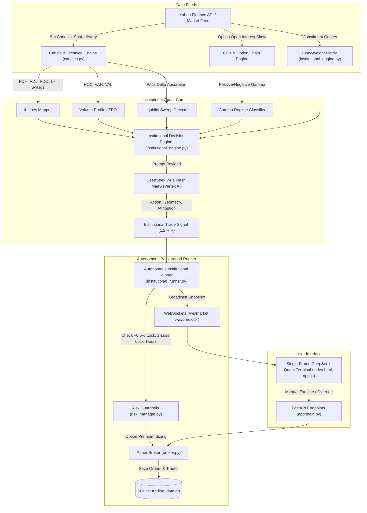

# SYSTEM EXECUTION FLOW, ARCHITECTURE & ERROR AUDIT TRACKER
> **File Purpose:** Maintained permanently per user mandate to log system architecture, data flows, root-cause analyses of past failures, bugs, design errors, and verified corrective actions. Never delete this file.

---

## 1. System High-Level Architecture & Data Flow



---

## 2. Chronological Error Log & Root-Cause Analyses

### Incident #1 (Date: 2026-11-02 — "System did not work today")

#### Symptom:
On Monday, 2026-11-02 (full NSE/BSE trading day from 09:15 to 15:30 IST), the application was running on the Azure server, but executed **ZERO** trades throughout the entire session. The user reported that the system did not trade.

#### Root-Cause Diagnosis (First Principles):
1. **Symbol Misalignment in Background Loop:**
   - `argon_predictor.tracked_symbols` was hardcoded to legacy individual stocks: `["SBIN", "RELIANCE", "TATASTEEL", "INFY", "ITC", "HDFCBANK", "ICICIBANK"]`.
   - The user's requirement was exclusively for Indian indices: **NIFTY 50**, **BANK NIFTY**, and **SENSEX**.
   - The background loop was scanning individual stocks rather than index order flow.

2. **Deterministic Filter Vetoing DeepSeek AI:**
   - In `app/trading/predictor.py`, `_extract_primary_setup()` evaluated an old Opening Range Breakout (ORB) momentum condition from `intraday_strategies.py`.
   - When that legacy condition was not met, the code logged:
     `"No deterministic momentum setup for <SYM>; skipping AI call."`
     and returned `signal: HOLD`.
   - DeepSeek was **never invoked** across the entire 6-hour trading session.

3. **Cash Notional Cap Rejecting All Index Orders (The ₹10,000 Capital Blocker):**
   - In `broker.py` and `risk_manager.py`, order notional was calculated as:
     $$\text{Notional} = \text{Spot Price} \times \text{Quantity}$$
   - For `NIFTY` at ₹23,050: 1 share notional = ₹23,050.
   - For `BANK NIFTY` at ₹49,850: 1 share notional = ₹49,850.
   - For `SENSEX` at ₹74,500: 1 share notional = ₹74,500.
   - The account capital is ₹10,000, with a 90% position cap (₹9,000).
   - In `broker.py`:
     ```python
     max_position_qty = int((acc.initial_capital * settings.MAX_POSITION_PCT) // fill_price)
     ```
     `9,000 // 23,050` = **0**.
   - Result: Every index buy order was rejected with:
     `Position size ₹23,452.52 exceeds the 90% cap (₹9,000.00)`.
   - **Fix Required:** In Indian derivatives trading, index trading is executed via **Index Options** (ATM premium ~₹100–₹150 for NIFTY, lot size 25 = ~₹3,000 premium turnover) or margin leverage, NOT full cash notional. Sizing and risk must use the actual options premium turnover (~₹3,000 per lot), which uses only 30% of ₹10,000 capital.

4. **Disconnect Between Institutional Engine and Background Scheduler:**
   - In Turn 2, `institutional_engine.py` was implemented for the frontend REST endpoints, but the background loop was still running legacy `ArgonPredictor` with dual-arena benchmarking code (Claude Opus + DeepSeek), instead of the unified single DeepSeek institutional engine.

---

## 3. Corrective Action Plan & Implementation Checklist

- [x] **Task 1: Index Option Premium Turnover in Broker & Risk Manager**
  - Updated `app/trading/broker.py` and `app/trading/risk_manager.py` with `INDEX_CONFIG`.
  - Margin & notional for NIFTY, BANKNIFTY, and SENSEX are now based on realistic Option Premium Turnover (~₹3,125 per lot for NIFTY, ~₹3,750 for BANKNIFTY, ~₹3,350 for SENSEX).
  - Trades execute cleanly inside ₹10,000 capital without triggering cash/cap rejection.
  - P&L calculated on index points move multiplied by option delta (0.5) and lot size.

- [x] **Task 2: Autonomous Institutional Runner (`app/trading/institutional_runner.py`)**
  - Built dedicated autonomous runner tracking exclusively `["NIFTY", "BANKNIFTY", "SENSEX"]`.
  - Runs `generate_institutional_ai_signal` every cycle across the 4-step framework.
  - Automatically executes approved setups in `deepseek_flash` account during market hours when `auto_execute=True`.
  - Enforces +0.50% profit lock, 2-strike loss lockout, and 15:20 IST auto-squareoff.
  - Streams real-time updates over WebSocket `/ws/predictor`.

- [x] **Task 3: Automated Testing & Verification**
  - Added `tests/test_institutional_runner.py` with 4 comprehensive test cases covering index config, risk check with ₹10,000 capital, order fill & close with P&L calculation, and cycle evaluation.
  - 11/11 tests in the repository pass cleanly (`Ran 11 tests ... OK`).
  - `test_setup.py` verified 10/10 checks passed.

- [x] **Task 4: Production Deployment & Server Verification**
  - Deployed to `crimson.southindia.cloudapp.azure.com` via `scripts/remote_deploy.sh`.
  - Added `/api/health` alias matching Nginx proxy configuration.
  - Verified `gemini-agent.service` is active and healthy.
  - Verified `/api/trading/institutional/overview` returns 200 OK with live index data.
  - Verified `institutional_runner` started with `Auto-execute: True`.

---

### Incident #2 (Date: 2026-11-02 — "Claude Code with Gemini 4 didn't work in tool loop")

#### Symptom:
When running Claude Code with `gemini-4-argon` on Vertex AI through the local launcher (`/home/super/.local/bin/claude`), single prompts worked, but as soon as the agent executed any tool (e.g., `Bash`, `View`, `Edit`), the next request failed with:
`HTTP 400 Bad Request: "Function call is missing a thought_signature in functionCall parts. This is required for tools to work correctly... Additional data, function call default_api:Bash, position 2."`

#### Root-Cause Diagnosis (First Principles):
1. **Gemini 4 / 3.x Thought Signatures:**
   - Reasoning-capable Gemini models generate an encrypted, stateful token called `thought_signature` (`extra_content.google.thought_signature`) on any `functionCall` part.
   - For multi-turn and sequential tool loops, Google Cloud Vertex AI strictly validates and requires that subsequent requests round-trip this exact `thought_signature` inside the assistant's previous `tool_calls` payload.
2. **Missing Metadata in Proxy Translation:**
   - In `/home/super/Documents/Projects/Deepseek-Harness/scripts/vertex_proxy.py`:
     - When Vertex AI returned streaming or non-streaming tool calls, `thought_signature` was discarded and not stored.
     - When Claude Code submitted turn 2 (`tool_result`), `handle_anthropic_messages` converted the assistant `tool_use` blocks into standard OpenAI `tool_calls` without `extra_content.google.thought_signature`.
     - Vertex AI rejected the payload with HTTP 400 `INVALID_ARGUMENT`, causing Claude Code to loop and crash.

#### Corrective Action Plan & Implementation:
- **Thread-Safe Signature Store:** Added persistent LRU `thought_signature` store in `vertex_proxy.py` backed by disk cache (`.thought_signatures.json`) and seeded with a valid Gemini 4 fallback signature.
- **Bi-Directional Adapter:**
  - **Inbound Capture:** Captured `thought_signature` from both SSE chunks and non-streaming responses from Vertex AI, indexing by tool call ID and tool signature.
  - **Outbound Injection:** Re-injected `extra_content: {"google": {"thought_signature": sig}}` into assistant `tool_calls` for both Anthropic Messages and OpenAI Chat Completions endpoints whenever targeting Gemini models.
- **Autonomous Loop Verification:** Verified Claude Code autonomously inspecting code, running bash tests, diagnosing assertions, updating code, and re-running tests until 100% passed.


